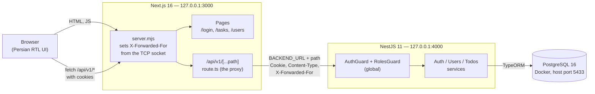
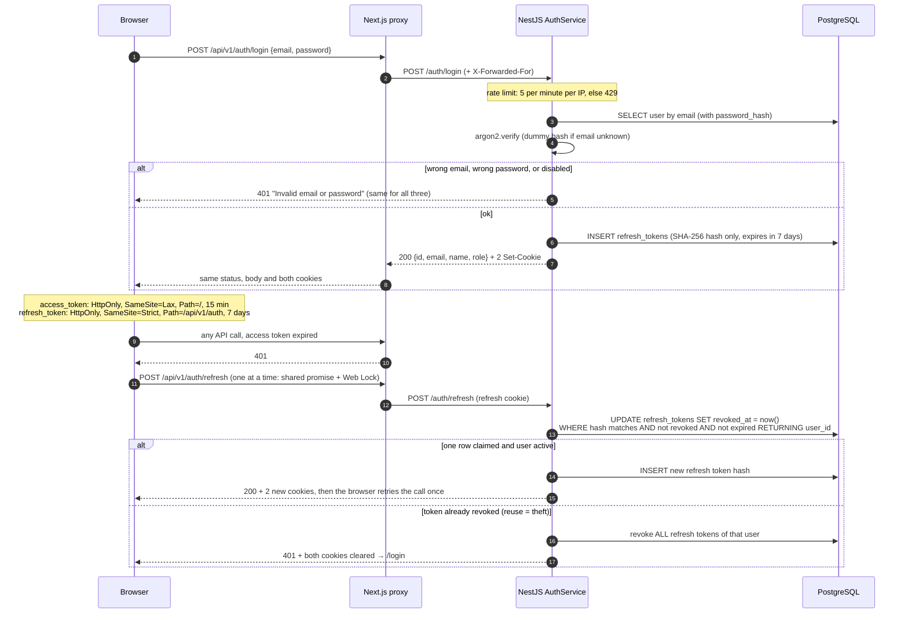
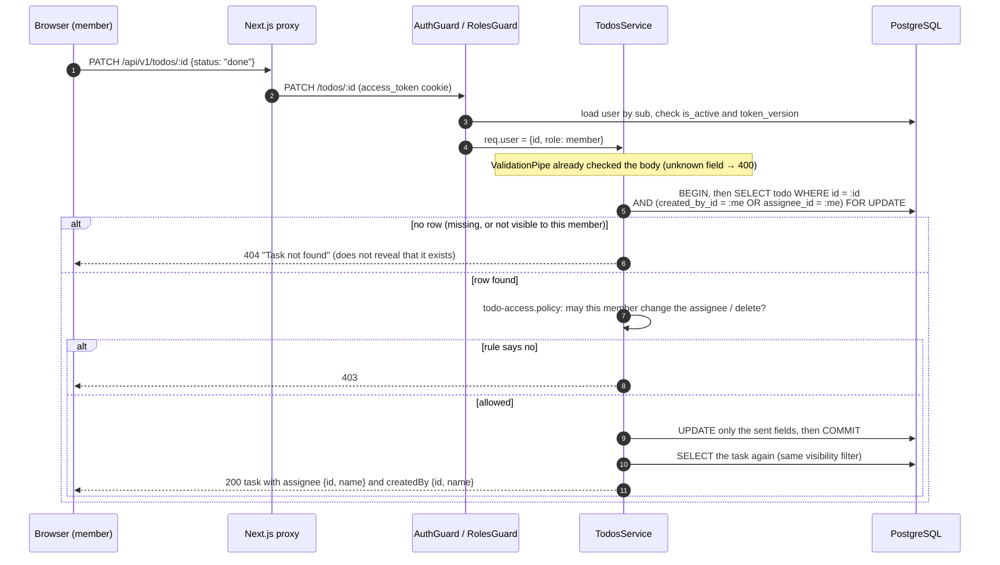
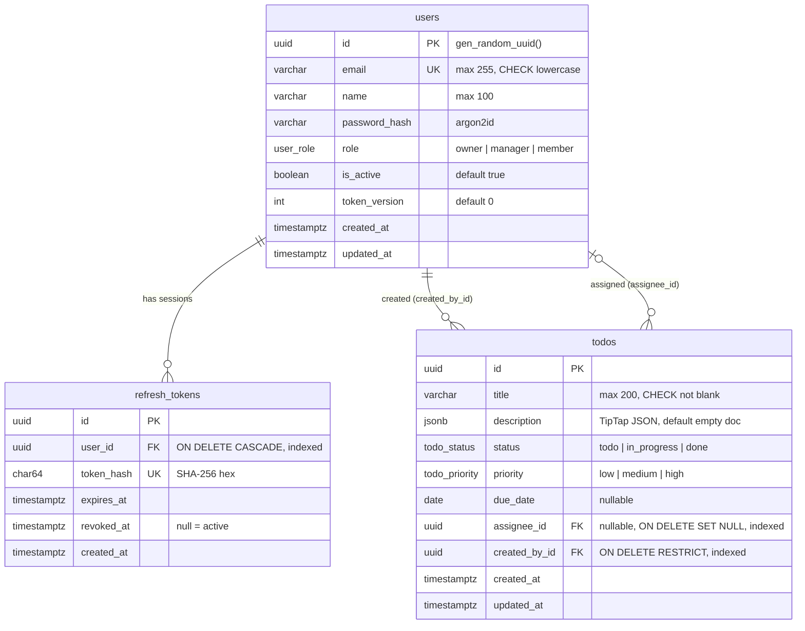

# Architecture

How the Task Board is built, in four pictures. Every statement here was checked
against the code at commit `e0d07c4` (2026-10-12). The diagrams are
[Mermaid](https://mermaid.js.org); GitHub renders them.

The rules behind these pictures live in [ABSTRACTION_PLAN.md](ABSTRACTION_PLAN.md)
(§3 architecture, §4 contracts, §5 security). This file describes what the code does.

## 1. Components: who talks to whom

Question: where does a request go, and where are the security decisions made?

- **The browser talks only to Next.js.** Client code calls `/api/v1/*`
  ([api-client.ts](../frontend/src/lib/api-client.ts)). `BACKEND_URL` is read only
  on the server, in the proxy ([route.ts](../frontend/src/app/api/v1/%5B...path%5D/route.ts)).
- **The proxy** forwards method, path, query string, body, `Cookie`, `Content-Type`
  and the client IP. It returns status, body, `Content-Type` and every `Set-Cookie`
  header. It refuses a non-GET request from a foreign `Origin` (or a cross-site
  `Sec-Fetch-Site`) with 403, a body over 512 KB with 413, an unreachable backend
  with 502, and a backend slower than 10 s with 504. All errors use the API error
  shape `{ statusCode, error, message, details }`.
- **`server.mjs`** replaces any `X-Forwarded-For` the client sent with the real TCP
  peer address. Reason: the login rate limit (5 per minute per IP) keys on this
  header, and plain `next dev` / `next start` keep a client-sent value.
- **`src/proxy.ts`** (the Next.js 16 name for middleware) only redirects a visitor
  without an `access_token` cookie to `/login`. It is a convenience, not security.
- **NestJS makes every security decision.** CORS is off. `AuthGuard` and
  `RolesGuard` are registered as global guards; routes opt out with `@Public()`
  (login, refresh, logout only).
- **Inside NestJS:** controller (HTTP + DTO) → service (rules + transactions) →
  TypeORM. A global `JsonDepthPipe` refuses bodies nested over 64 levels, then a
  global `ValidationPipe` rejects unknown fields; `AllExceptionsFilter`
  gives every error the same shape.

## 2. Login and refresh-token rotation

Question: how does a session start, how does it stay alive, and what happens when
a refresh token is stolen?

Facts behind the picture ([auth.service.ts](../backend/src/modules/auth/auth.service.ts),
[auth.controller.ts](../backend/src/modules/auth/auth.controller.ts)):

- The access token is a JWT (HS256) with claims `sub` (user id) and `tv` (token
  version). Its lifetime comes from `JWT_ACCESS_TTL_SECONDS` (default 900 = 15 min).
- The refresh token is 32 random bytes, not a JWT. Only its SHA-256 hash is stored.
- The old refresh token is claimed with one atomic `UPDATE … RETURNING`. So two
  requests with the same token cannot both succeed; the second one counts as reuse.
  This is why the browser client sends only one refresh at a time
  ([api-client.ts](../frontend/src/lib/api-client.ts)): a shared promise inside a
  tab, and a Web Lock across tabs.
- The refresh cookie has `Path=/api/v1/auth`, so the browser sends it only to the
  auth endpoints, never to pages or task calls.
- Logout is public (it works with an expired access token). It revokes the current
  refresh token and clears both cookies.

**How a disabled user is cut off at once.** `AuthGuard`
([auth.guard.ts](../backend/src/common/guards/auth.guard.ts)) verifies the JWT and
then loads the user from the database on **every** request. It returns 401 when the
user is missing, `is_active = false`, or `token_version ≠ tv`. Disabling a user or
changing their role (in [users.service.ts](../backend/src/modules/users/users.service.ts))
adds 1 to `token_version` and revokes all their refresh tokens, in one transaction.
So an old access token fails on the next request, not after 15 minutes.

## 3. A task request with row-level access

Question: how can a member never see or change another person's task?

- **Visibility is part of the SQL query**, not a check after loading.
  `scopeTodosToUser()` in [todo-access.policy.ts](../backend/src/modules/todos/todo-access.policy.ts)
  adds `(created_by_id = :me OR assignee_id = :me)` for members. Owners and managers
  get no filter. List, read, update and delete all use it, so a filter in the URL
  cannot widen what a member sees.
- **Role-level rules** ("only the owner may manage users") are `@Roles(...)` on the
  controller, enforced by `RolesGuard` with 403.
- **Row-level rules** for members, in the same policy file: a new task may be
  assigned only to themselves or nobody; the assignee may change only on tasks they
  created, and only to themselves or nobody; delete only tasks they created.
- A new assignee must be an active user (400 with a field error on `assigneeId`
  otherwise). The user row is read with a share lock, so a parallel disable cannot
  slip in between.

The full permission matrix is in the [README](../README.md#permission-matrix).

## 4. Data model

Question: what is stored, and how are the tables linked? (Source of truth:
[the migration](../backend/src/database/migrations/1791722918782-InitialSchema.ts).)

- `todos.status` is also indexed (board filter).
- Users are never deleted, only disabled (`is_active = false`). A disabled user
  cannot become a **new** assignee; tasks already assigned to them keep the assignment.
- The schema changes only through migrations. `synchronize` is `false` in
  [data-source.ts](../backend/src/config/data-source.ts), which the app, the
  TypeORM CLI (through [cli-data-source.ts](../backend/src/config/cli-data-source.ts)),
  the seed and the e2e tests all share. TypeORM's own `CREATE EXTENSION` on
  connect is turned off (`installExtensions: false`).

### The task description (TipTap JSON)

- Stored as `jsonb`. HTML is never stored or accepted.
- The backend validator ([tiptap.validator.ts](../backend/src/modules/todos/tiptap/tiptap.validator.ts))
  walks the tree and rejects anything not on the allowlist: nodes `doc`,
  `paragraph`, `text`, `heading` (levels 1–3), `bulletList`, `orderedList`,
  `listItem`, `blockquote`, `hardBreak`; marks `bold`, `italic`, `link`. A link
  `href` must be `http:` or `https:`. Unknown attributes, bad nesting, depth over
  20 and size over 100 KB are rejected. An empty document is valid.
- The frontend has **one** extension list
  ([tiptap-extensions.ts](../frontend/src/lib/tiptap-extensions.ts)) limited to the
  same allowlist. The editor and the read-only viewer
  ([description-view.tsx](../frontend/src/components/tasks/description-view.tsx),
  a TipTap instance with `editable: false`) both use it, so the same JSON renders
  the same way in both places.
- Before saving and after loading, the frontend keeps only `href` on link marks.
  The viewer then always renders links with `target="_blank"` and
  `rel="noopener noreferrer nofollow"`.

## 5. Folder map

| Folder | What it holds |
| ------ | ------------- |
| `backend/src/common/` | Global guards (`AuthGuard`, `RolesGuard`), the global `JsonDepthPipe`, decorators (`@Public`, `@Roles`, `@CurrentUser`), the error filter |
| `backend/src/config/` | Env validation (fails fast), the one TypeORM data source and its CLI entry (`cli-data-source.ts`) |
| `backend/src/modules/auth/` | Login, refresh, logout, me; refresh-token entity |
| `backend/src/modules/users/` | Owner-only user management, last-owner rule |
| `backend/src/modules/todos/` | Task CRUD, `todo-access.policy.ts`, TipTap validator |
| `backend/src/database/` | Migrations and the idempotent seed |
| `backend/test/e2e/` | Permission tests against a real `taskboard_test` database |
| `frontend/server.mjs` | Custom server (client IP from the socket) |
| `frontend/scripts/` | `browser-check.mjs`: 93 checks in headless Chrome (`npm run check:browser`) |
| `frontend/src/app/api/v1/` | The proxy to NestJS |
| `frontend/src/app/(auth)/`, `(app)/` | Login page; signed-in shell with tasks and users pages |
| `frontend/src/components/` | Headless UI wrappers, task board and dialogs, users screen |
| `frontend/src/lib/` | API client, TipTap extension list, Persian labels, date format, button-hiding rules |

Frontend and backend share no code. The frontend mirrors the API types it needs in
[types/api.ts](../frontend/src/types/api.ts).
